# Creating and Signing In as an Admin

## Overview

An **Admin** has full access to Socho and can manage studies, users, clients, and user roles.

This section explains how to create an Admin account and sign in to Socho.

---

## Creating an Admin Account

By default, every new user is assigned the **Participant** role. To create an Admin account, you need to use the Interactive Elixir (IEx) shell.

### Step 1: Open the Socho Project

Open the Socho project in Visual Studio Code.

Open a new terminal and make sure you are inside the project directory.

### Step 2: Start the Phoenix Server

Run the following command:

```bash
iex -S mix phx.server
```

If the server starts successfully, you will see output similar to:

```text
[info] Running SochoWeb.Endpoint at http://localhost:4000

Interactive Elixir
iex(1)>
```

The `iex(1)>` prompt indicates that the Interactive Elixir (IEx) shell is ready to accept commands.

---

### Step 3: Load the User Administration Module

Import the `UserAdmin` module by running the following command:

```elixir
alias Socho.Accounts.UserAdmin
```

Expected output:

```elixir
Socho.Accounts.UserAdmin
```

---

### Step 4: Create an Admin User

Run the following command:

```elixir
UserAdmin.create_user(
  "example@gmail.com",
  "Password123!",
  :admin
)
```

Replace:

- `example@gmail.com` with the email address you want to use.
- `Password123!` with a secure password.

Result:

The Admin account is created successfully.

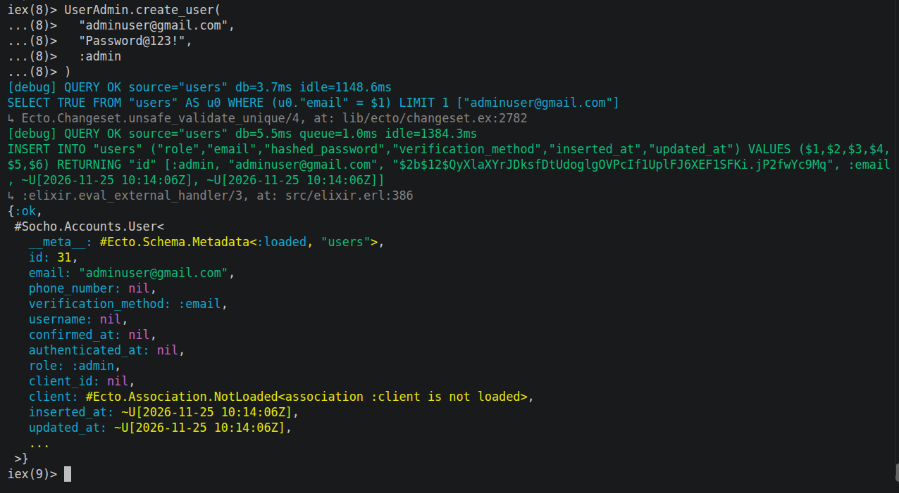

**Figure 1:** Admin account created successfully.

---

## Signing In as an Admin

After creating the Admin account, sign in using the same email address.

### Step 1

Open your browser and go to:

```text
http://localhost:4000
```

The Socho home page opens.

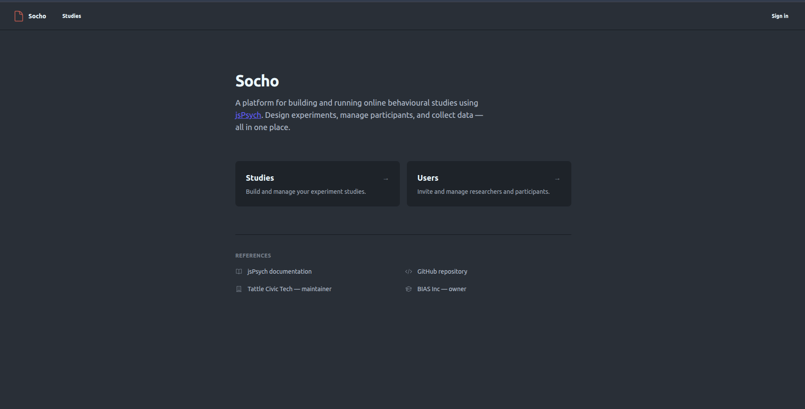

**Figure 2:** The Socho home page.

---

### Step 2

Click **Sign In**.

**Result:** The Sign In page opens.

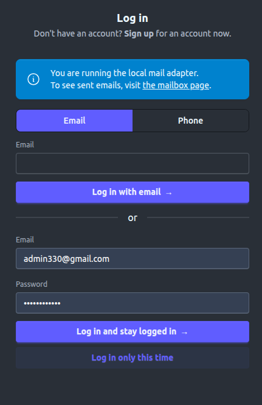

**Figure 3:** The Sign In page.

---

### Step 3

Enter the same email address and password that you used while creating the Admin account.

Click **Log in and stay logged in**.

Find the blue notification box above the Email field, then click the **mailbox page** link.

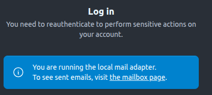

**Figure 4:** Mailbox page link.

---

### Step 4

The Mailbox page opens.

Open the latest email.

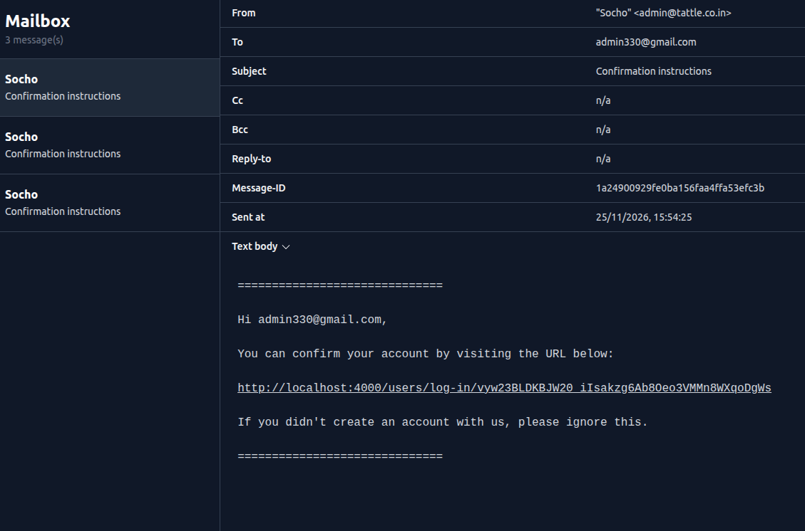

**Figure 5:** The Socho Mailbox page.

---

### Step 5

Click the confirmation link in the email.

The **Confirm my account** page opens.

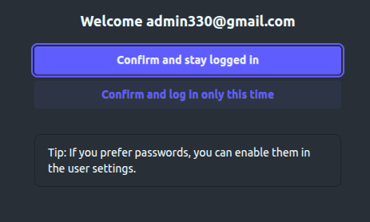

**Figure 6:** The Socho Confirm my account page.

---

### Step 6

Click **Confirm and stay logged in**.

**Result:**

Your Admin account has been created successfully, and you now have full access to Socho.

## What an Admin Can Do

An **Admin** has full access to all features in Socho. Admins can manage studies, users, clients, and system settings.

An Admin can:

- Create, edit, preview, publish, and delete studies.
- Build surveys using blocks and templates.
- View participant responses and export study data as CSV.
- Create, edit, and delete clients.
- Assign studies to clients.
- Invite participants to clients.
- View and manage all users.
- Invite new users.
- Import users using a CSV file.
- Edit user information, including display name, client, and role.
- Create Admin, Manager, and Participant accounts.
- Promote or change user roles.
- Access all studies and clients across the system.

---

# Creating and Signing In as a Manager

## Overview

A **Manager** can create and manage studies, manage clients, assign studies to clients, and invite participants. However, a Manager cannot create Admin or Manager accounts or change user roles to Admin or Manager.

This section explains how to create a Manager account and sign in to Socho.

---

## Creating a Manager Account

Only an **Admin** can create a Manager account.

### Step 1: Sign in as an Admin

Sign in using an Admin account.

After signing in successfully, the Socho home page opens.

---

### Step 2: Open the Users Page

Click the **Users** card on the home page or click **Users** from the navigation bar.

**Result:** The **Users** page opens and displays the list of all users.

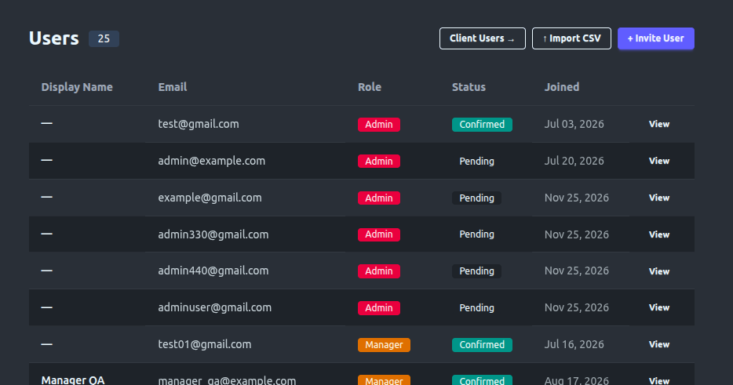

**Figure 7:** The Users page.

---

### Step 3: Open the Invite User Form

On the **Users** page, click **+ Invite User** in the top-right corner.

**Result:** The **Invite a New User** form opens.

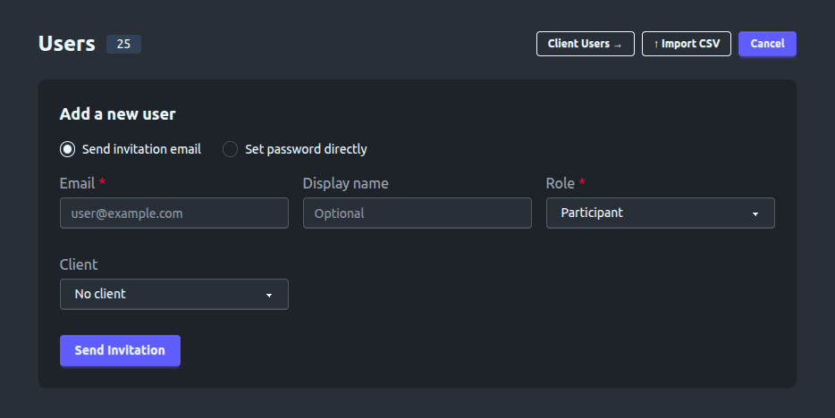

**Figure 8:** The Invite a New User form.

---

### Step 4: Send an Invitation

1. Enter the manager's **Email address**.
2. (Optional) Enter a **Display name**.
3. Select **Manager** from the **Role** dropdown.
4. Click **Send Invitation**.

**Result:** A confirmation message appears at the top of the page stating:

> **Invitation sent to [email address]**

This confirms that the invitation has been sent successfully.

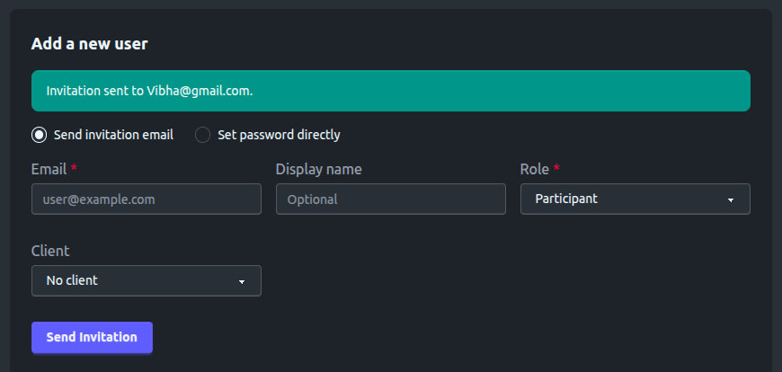

**Figure 9:** Invitation sent confirmation.

---

### Step 5: View the Manager Account

On the **Users** page, locate the Manager account you just invited and click **View**.

**Result:** The selected user's details page opens.

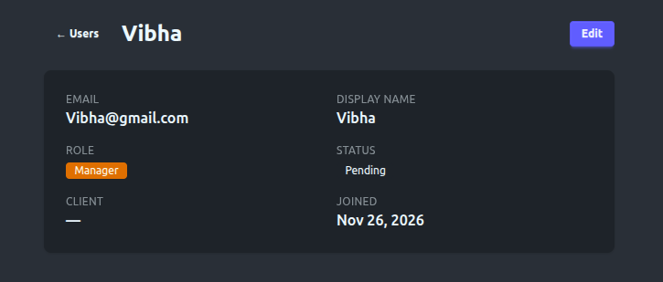

**Figure 10:** The selected user's details page opens.

From this page, you can edit the manager's information, such as the display name, role (if permitted), and assigned client.

> **Note:** At this stage, the Manager account has been invited but has not yet been confirmed.

Copy the Manager's email address, then sign out of the Admin account.

---

# Signing In as a Manager

After creating the Manager account, sign in using the same email address.

---

### Step 1

The Socho home page opens.


**Figure 11:** The Socho home page.

---

### Step 2

Click **Sign In**.

**Result:** The Sign In page opens.


**Figure 12:** The Sign In page.

---

### Step 3

Enter the email address that was used when creating the Manager account.

Click **Log in and stay logged in**.

Find the blue notification box above the Email field, then click the **mailbox page** link.


**Figure 13:** Mailbox page link.

---

### Step 4

The Mailbox page opens.

Open the latest email.


**Figure 14:** The Socho Mailbox page.

---

### Step 5

Click the confirmation link in the email.

The **Confirm my account** page opens.


**Figure 15:** The Socho Confirm my account page.

---

### Step 6

Click **Confirm and stay logged in**.

**Result:**

Your Manager account has been created successfully. You can now sign in and manage studies assigned to you.

## What a Manager Can Do

A **Manager** can manage studies and clients but has limited administrative permissions.

A Manager can:

- Create, edit, preview, publish, and delete studies.
- Build surveys using blocks and templates.
- View participant responses and export study data as CSV.
- Create and manage clients.
- Assign studies to clients.
- Invite participants to clients.
- Create Participant accounts.
- View and manage studies that they have permission to access.

A Manager cannot:

- Create Admin accounts.
- Create Manager accounts.
- Change a user's role to Admin or Manager.
- Perform actions that require Admin privileges.

For detailed information about Admin and Manager features and workflows, see the User Roles Guide:

https://docs.google.com/document/d/1qVmNxrjSerOroCY-C5yvZvooohr8enEKAekTpVUsJnc/edit?tab=t.0#heading=h.gg6do12z4hiz

---

# Creating and Signing In as a Participant

## Overview

A **Participant** can access and complete studies that have been assigned to them. Participants cannot create or manage studies, users, clients, or user roles.

This section explains how to create a Participant account and sign in to Socho.

---

## Creating a Participant Account

Only an **Admin** or **Manager** can create a Participant account.

### Step 1: Sign in as an Admin or Manager

Sign in using an Admin or Manager account.

After signing in successfully, the Studies page opens.

---

### Step 2: Open the Users Page

Click the **Users** card on the home page or click **Users** from the navigation bar.

**Result:** The **Users** page opens and displays the list of all users.


**Figure 16:** The Users page.

---

### Step 3: Open the Invite User Form

On the **Users** page, click **+ Invite User** in the top-right corner.

**Result:** The **Invite a New User** form opens.


**Figure 17:** The Invite a New User form.

---

### Step 4: Send an Invitation

1. Enter the participant's **Email address**.
2. (Optional) Enter a **Display name**.
3. Select **Participant** from the **Role** dropdown.
4. Click **Send Invitation**.

**Result:** A confirmation message appears at the top of the page stating:

> **Invitation sent to [email address]**

This confirms that the invitation has been sent successfully.


**Figure 18:** Invitation sent confirmation.

---

### Step 5: View the Participant Account

On the **Users** page, locate the Participant account you just invited and click **View**.

**Result:** The selected user's details page opens.

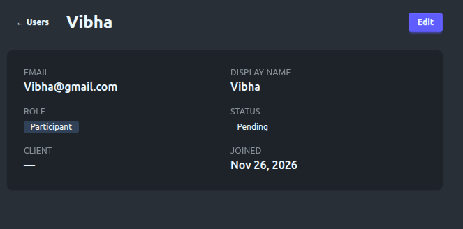

**Figure 19:** The selected user's details page opens.

From this page, you can edit the participant's information, such as the display name and assigned client.

> **Note:** At this stage, the Participant account has been invited but has not yet been confirmed.

Copy the Participant's email address, then sign out of the current account.

---

# Signing In as a Participant

After creating the Participant account, sign in using the same email address.

---

### Step 1

The Socho home page opens.


**Figure 20:** The Socho home page.

---

### Step 2

Click **Sign In**.

**Result:** The Sign In page opens.


**Figure 21:** The Sign In page.

---

### Step 3

Enter the email address that was used when creating the Participant account.

Click **Log in and stay logged in**.

Find the blue notification box above the Email field, then click the **mailbox page** link.


**Figure 22:** Mailbox page link.

---

### Step 4

The Mailbox page opens.

Open the latest email.


**Figure 23:** The Socho Mailbox page.

---

### Step 5

Click the confirmation link in the email.

The **Confirm my account** page opens.


**Figure 24:** The Socho Confirm my account page.

---

### Step 6

Click **Confirm and stay logged in**.

**Result:**

Your Participant account has been created successfully. You can now sign in and participate in studies that have been assigned to you.

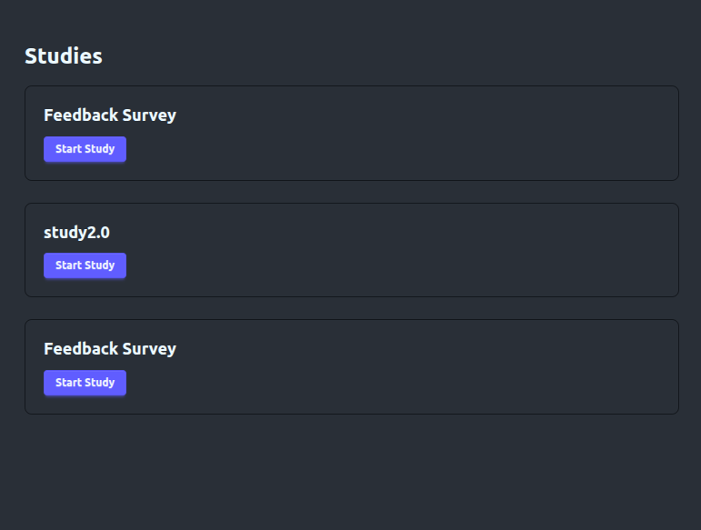

**Figure 25:** The Participant dashboard or Studies page (if applicable).

## What a Participant Can Do

A **Participant** can view and complete studies that have been assigned to them. Participants have limited access and cannot manage studies, users, clients, or system settings.

A Participant can:

- View all studies assigned to them from the **Studies** dashboard.
- Open any assigned study.
- Complete and submit assigned studies.
- View only the studies assigned to their account.

A Participant cannot:

- Create, edit, publish, or delete studies.
- Create or manage users.
- Create or manage clients.
- Change user roles.
- Access administrative features.

---

## Completing an Assigned Study

### Step 1: Open the Studies Dashboard

Sign in using your Participant account.

**Result:** The **Studies** dashboard opens and displays all studies assigned to you.


**Figure 26:** The Participant Studies dashboard showing assigned studies.

---

### Step 2: Open an Assigned Study

Click the study you want to complete.

**Result:** The selected study opens.


**Figure 27:** The selected study.

---

### Step 3: Complete the Study

Read each question and enter your responses.

Click **Continue** (or the appropriate navigation button) until you reach the last page of the study.

---

### Step 4: Submit the Study

After answering all required questions, click **Submit** (or the final **Continue** button).

**Result:** Your responses are submitted successfully. Blank page displayed after the study is submitted.


---

### Step 5: Open a Completed Study

If you open a study that you have already completed, After completing and submitting the study.

**Result:** The following message is displayed:

> **You have already completed this study. Thank you!**
